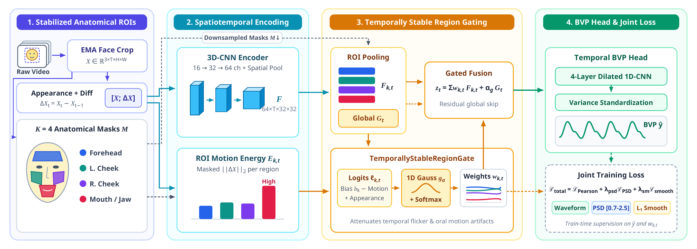
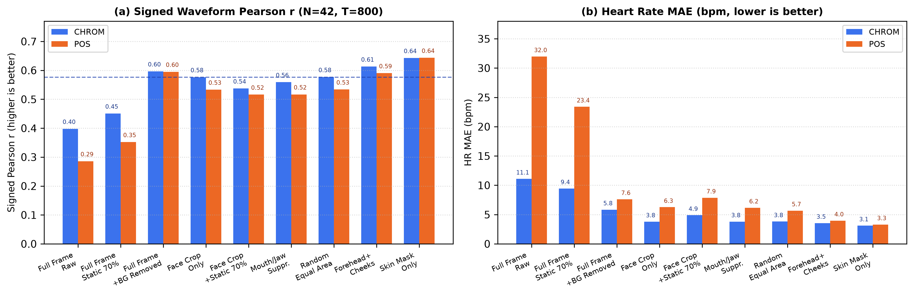
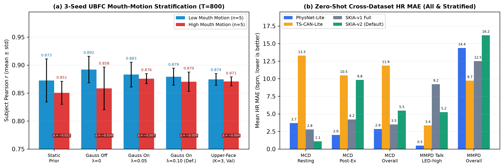
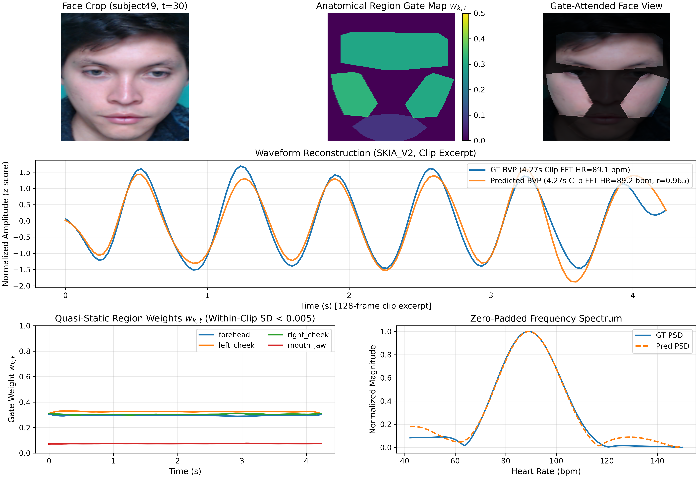
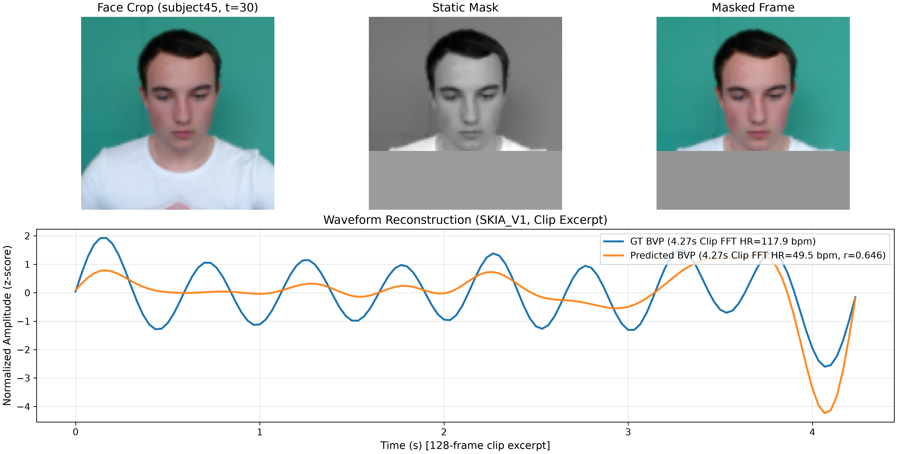

# SKIA-rPPG-v2


Official PyTorch implementation of:

**SKIA: Temporally Stable Anatomy-Aware Region Gating for Remote Photoplethysmography**

Van-Truong Le<sup>1,2</sup>, Viet-Tham Huynh<sup>1,2</sup>, and Minh-Triet Tran<sup>1,2</sup>  
<sup>1</sup> Faculty of Information Technology, University of Science, Ho Chi Minh City, Vietnam  
<sup>2</sup> Vietnam National University, Ho Chi Minh City, Vietnam

> **Repository Separation:** This repository (`SKIA-rPPG-v2`) hosts the audited **SKIA-v2** codebase, multi-seed experimental pipeline, capacity-matched `-Lite` baselines, and ACIIDS 2027 benchmarks. The original baseline **SKIA-v1** codebase is preserved separately at **[lee-vtruong/SKIA-rPPG](https://github.com/lee-vtruong/SKIA-rPPG)**.

<p align="center">
  
</p>
<p align="center">
  <em>Overview of the SKIA-v2 framework (vector PDF also available at <code>figures/skia_v2_overview.pdf</code>).</em>
</p>

---

## 1. Overview & Key Contributions

Earlier bottom-30% row masking in **SKIA-v1** (`static_70`) was motivated by suppressing lower-face speech and jaw articulation (**H1**), but when applied to uncropped frames it simultaneously discarded non-skin shirts, shoulders, and lower walls (**H2**). **SKIA-v2** systematically disentangles H1 vs. H2, audits six defects in the prior pipeline, and benchmarks a regularized landmark-guided region gating architecture across three real-video cohorts (`UBFC-rPPG`, `MCD-rPPG`, `MMPD`).

1. **H1 vs. H2 Deconfounding Audit (Experiment A):** Evaluates 9 controlled spatial variants—including an uncropped skin-thresholded control (`full_frame_bg_removed`)—on both the 32-subject Discovery split (`train+val`) and all 42 UBFC-rPPG subjects (`T = 800`), with aligned Beer-Lambert POS polarity and Holm–Bonferroni correction (`m = 8`).
2. **Codebase Integrity Audit & Capacity-Matched Benchmarks (Experiment B):** Replaces test-split checkpointing, terminal scale collapse, coarse `128`-pt FFT bins, POS sign inversion, and cross-subject flow leakage with a unified pipeline (`26/6/10` UBFC split, validation-only selection across 3 seeds × 20 epochs, `4096`-pt parabolic FFT + Welch PSD + oximeter HR audit) compared fairly against compact `-Lite` baselines (`22K–456K` params).
3. **Multi-Seed 2 × 3 Ablation & Gate Mechanism Analysis (Experiment C):** Distinguishes **SKIA-v2 Default** (`K=4, λ=0.10`) from validation-selected configurations (**Val-Sel `K=4, λ=0.05`** and **Val-Sel `K=3` Upper-Face**), paired 95% bootstrap CIs against `Static Prior`, High-Mouth-Motion sensitivity, and measured gate stability (`within-clip SD < 0.005`), showing the gate functions as a **quasi-static clip-adaptive anatomical prior** over non-causal `128`-frame (`4.27 s`) windows.
4. **Preliminary Zero-Shot Cross-Dataset Boundary Mapping (Experiment D):** Tests UBFC-trained checkpoints zero-shot on `MCD-rPPG` (5 subjects, 10 sessions) and `MMPD` (4 subjects, 16 sessions), separating `0-lag Pearson` (primary) from oracle-aligned diagnostic lag correlation (`r_lag^oracle`), reporting resting gains (`1.09 bpm` MAE on MCD-rPPG Resting) alongside post-exercise, dim-light, and rotation failure modes.

---

## 2. Method & Resolved Codebase Defects

### Architecture (`src/roi_extractor.py`, `src/skia_v2_model.py`)

- **EMA-Stabilized Landmark ROIs (`StabilizedFaceROIExtractor`):** Extracts facial landmarks using OpenCV YuNet + 68-pt FacemarkLBF (used uniformly on UBFC-rPPG) or MediaPipe FaceLandmarker (`478` pts), smooths bounding boxes via EMA (`α = 0.85`), and builds `K = 4` dilated anatomical convex hull masks (`forehead`, `left_cheek`, `right_cheek`, `mouth_jaw`; `K = 3` omits `mouth_jaw`) on `128 × 128` crops over `128`-frame (`4.27 s`) clips.
- **Dual-Stream 3D-CNN & Region Pooling (`SKIANetV2`):** Feeds 6-channel `[X; ΔX]` into a `16 → 32 → 64` 3D-CNN encoder (`F ∈ R^{64×T×32×32}`) and computes per-region L2 motion energy `E_{k,t}` and pooled features `F_{k,t}` alongside global context `G_t`.
- **Non-Causal Quasi-Static Region Gate (`TemporallyStableRegionGate`):** Combines learnable priors `b_k = [0.6, 0.5, 0.5, -0.8]`, standardized motion energy, and appearance projections, smooths pre-softmax logits with a symmetric 1D Gaussian filter (`K_s = 11`, `σ_g = 2.75`, spanning `±5` frames = `±0.167 s`), and learns post-softmax temporal stability via `SKIAv2Loss`:
  $$\mathcal{L}_{\text{total}} = \big(1 - \rho(\hat{y}, y)\big) + \lambda_{\text{psd}} \mathcal{L}_{\text{PSD}}(\hat{y}, y) + \lambda_{\text{smooth}} \frac{1}{T-1}\sum_{t=2}^T \|w_{:,t} - w_{:,t-1}\|_1, \quad \lambda_{\text{psd}} = 0.2$$
  followed by a 4-layer dilated 1D BVP head and in-graph variance standardization (`standardize_waveform`).

### Six Audited Defects Resolved from SKIA-v1

| # | Audited Issue | Root Cause in Legacy Code | Resolution in SKIA-v2 |
|---|---|---|---|
| 1 | Test-split checkpointing | Selected checkpoints by Test `r` (`32/10` split); mixed resolutions | Inherited `26/6/10` subject-disjoint split; validation-only checkpointing; unified `128×128`, `T_clip = 128` |
| 2 | Terminal output scale collapse | Scale-invariant Pearson loss + AdamW decay shrank head weights (`σ_ŷ ≈ 1e-8`) | Added `standardize_waveform` in `SKIANetV2` and `SKIANetLite` (fixes scale degeneracy only) |
| 3 | Coarse FFT HR quantization | `128`-pt rFFT gave `14.06 bpm/bin` steps | `4096`-pt Hann parabolic FFT + multi-window (`4.27–26.7 s`), Welch PSD, and raw oximeter HR audits |
| 4 | POS polarity mismatch | Missing Beer-Lambert inversion (`-H_out`) yielded `r < 0` vs. positive `\|r\|` winrates | Enforced `-H_out` systolic polarity in `baselines_classical.py` matching CHROM/GREEN |
| 5 | H1 vs. H2 confounding | Horizontal `70%` row cutoff discarded clothing while cropping changed scale | Added `full_frame_bg_removed` control & separated Discovery (`N=32`) vs. Full (`N=42`) |
| 6 | Optical-flow leakage & flicker | Persistent cross-subject flow masks without temporal smoothing | Per-subject EMA reset + Gaussian-smoothed `TemporallyStableRegionGate` + `L_smooth` |

---

## 3. Main Experimental Results (`UBFC-rPPG`, `T = 800`, 3 Seeds × 20 Epochs)

### Experiment A — Disentangling H1 vs. H2 (`UBFC-rPPG`, `T = 800`, Aligned POS Polarity)

<p align="center">
  
</p>

| Method | Spatial Variant | Pearson ($N=32$) | Pearson ($N=42$) | HR MAE (bpm) | SNR (dB) | Win% vs. Crop | $p_{\text{Wil}}$ ($N=42$) | $p_{\text{Holm}}$ ($m=8$) | 95% CI ($\Delta r$) |
|---|---|---:|---:|---:|---:|---:|---:|---:|---|
| CHROM | `full_frame_raw` | `0.4090` | `0.3978` | `11.09` | `-3.76` | `14.3%` | `< 1e-4` | `< 1e-4` | `[-0.229, -0.131]` |
| CHROM | `full_frame_static_70` | `0.4448` | `0.4507` | `9.45` | `-2.24` | `16.7%` | `< 1e-4` | `< 1e-4` | `[-0.178, -0.080]` |
| CHROM | `full_frame_bg_removed` | `0.5736` | `0.5966` | `5.84` | `+0.94` | `59.5%` | `0.1913` | `0.3826` | `[-0.015, +0.053]` |
| CHROM | `face_crop_only` | `0.5578` | `0.5764` | `3.79` | `-0.38` | — | — | — | — |
| CHROM | **`skin_mask_only`** | **`0.6314`** | **`0.6427`** | **`3.11`** | **`+1.96`** | **`81.0%`** | `< 1e-4` | `0.0002` | `[+0.038, +0.094]` |
| CHROM | `face_static_70` | `0.5233` | `0.5374` | `4.89` | `-0.99` | `21.4%` | `< 1e-4` | `< 1e-4` | `[-0.053, -0.026]` |
| CHROM | `mouth_jaw_suppression` | `0.5459` | `0.5591` | `3.80` | `-0.77` | `23.8%` | `0.0004` | `0.0018` | `[-0.029, -0.007]` |
| CHROM | `forehead_cheeks_only` | `0.6081` | `0.6131` | `3.55` | `+1.27` | `61.9%` | `0.0535` | `0.1606` | `[+0.007, +0.067]` |
| CHROM | `random_equal_area_mask` | `0.5582` | `0.5768` | `3.81` | `-0.35` | `61.9%` | `0.3651` | `0.3826` | `[-0.001, +0.002]` |
| POS | `full_frame_raw` | `0.2945` | `0.2858` | `31.98` | `-6.47` | `11.9%` | `< 1e-4` | `< 1e-4` | `[-0.291, -0.200]` |
| POS | `full_frame_static_70` | `0.3470` | `0.3520` | `23.40` | `-4.87` | `9.5%` | `< 1e-4` | `< 1e-4` | `[-0.222, -0.140]` |
| POS | `full_frame_bg_removed` | `0.5789` | `0.5951` | `7.61` | `+1.43` | `76.2%` | `0.0011` | `0.0045` | `[+0.022, +0.097]` |
| POS | `face_crop_only` | `0.5116` | `0.5332` | `6.26` | `-1.07` | — | — | — | — |
| POS | **`skin_mask_only`** | **`0.6317`** | **`0.6434`** | **`3.30`** | **`+2.72`** | **`85.7%`** | `< 1e-4` | `< 1e-4` | `[+0.082, +0.141]` |
| POS | `face_static_70` | `0.4946` | `0.5161` | `7.87` | `-1.11` | `33.3%` | `0.0551` | `0.1103` | `[-0.039, +0.004]` |
| POS | `mouth_jaw_suppression` | `0.4945` | `0.5168` | `6.16` | `-1.48` | `28.6%` | `0.0009` | `0.0044` | `[-0.025, -0.008]` |
| POS | `forehead_cheeks_only` | `0.5885` | `0.5902` | `3.96` | `+0.98` | `71.4%` | `0.0053` | `0.0160` | `[+0.020, +0.096]` |
| POS | `random_equal_area_mask` | `0.5125` | `0.5339` | `5.67` | `-1.06` | `61.9%` | `0.1668` | `0.1668` | `[-0.000, +0.002]` |

### Experiment B — Capacity-Matched `-Lite` Benchmark & HR Estimator Audit (`26/6/10` UBFC Split)

Deep baselines in `src/baselines_deep.py` are compact `-Lite` implementations (`21.9K–455.6K` params) capacity-matched for uniform GPU memory/channel comparison (`PhysNet-Lite` `455,649` vs. `~0.77M`, `TS-CAN-Lite` `38,931` at `72×72` vs. `~0.53M`, `EfficientPhys-Lite` `21,880` at `72×72`, `PhysFormer-Lite` `147,905` 2-layer `D=64` vs. `7.03M`).

| Model | Val $r$ ↑ | Subj $r$ ↑ | Spec 26.7s MAE ↓ | Welch 26.7s ↓ | Spec 10s ↓ | Spec 4.27s ↓ | vs. Sensor HR ↓ | SNR (dB) ↑ | Params | E2E FPS |
|---|---:|---:|---:|---:|---:|---:|---:|---:|---:|---:|
| `CHROM (face_crop)` | — | `0.6361 ± 0.0000` | `2.29 ± 0.00` | `2.29` | `2.47` | `5.92` | `2.73` | `-0.10` | `0` | — |
| `POS (face_crop)` | — | `0.6022 ± 0.0000` | `4.70 ± 0.00` | `4.70` | `4.99` | `7.85` | `2.66` | `-0.61` | `0` | — |
| `PhysNet-Lite` | **`0.8365`** | `0.8319 ± 0.0142` | `0.17 ± 0.02` | `0.31 ± 0.04` | `0.50 ± 0.01` | `1.27 ± 0.06` | **`2.79 ± 0.02`** | **`7.15`** | `455,649` | `173.48` |
| **`TS-CAN-Lite`** | `0.7615` | **`0.8811 ± 0.0063`** | `0.17 ± 0.02` | `1.30 ± 0.67` | `0.46 ± 0.01` | `1.57 ± 0.17` | `2.80 ± 0.02` | `5.51` | `38,931` | `169.02` |
| `EfficientPhys-Lite` | `0.6688` | `0.8368 ± 0.0057` | `0.31 ± 0.01` | `0.45 ± 0.09` | `0.53 ± 0.00` | `2.04 ± 0.13` | `2.84 ± 0.01` | `3.68` | `21,880` | **`180.66`** |
| `PhysFormer-Lite` | `0.7176` | `0.8567 ± 0.0208` | **`0.16 ± 0.02`** | `0.41 ± 0.02` | `0.47 ± 0.02` | `1.51 ± 0.03` | **`2.79 ± 0.02`** | `5.86` | `147,905` | `180.57` |
| `SKIA-v1 Raw` | `0.7601` | `0.8263 ± 0.0230` | `0.49 ± 0.43` | `0.31` | `0.52` | `1.79` | `3.03` | `5.49` | `103,905` | `176.84` |
| `SKIA-v1 Full` | `0.7781` | `0.8034 ± 0.0488` | `1.07 ± 0.04` | `0.32 ± 0.04` | `0.55 ± 0.03` | `1.65 ± 0.44` | `3.48 ± 0.07` | `5.57` | `111,105` | `151.09` |
| `SKIA-v2 Default (K=4, λ=0.10)` | `0.8010` | `0.8748 ± 0.0152` | `0.18 ± 0.04` | `0.37 ± 0.04` | `0.46 ± 0.02` | `1.30 ± 0.10` | `2.84 ± 0.03` | `6.57` | `115,828` | `165.89` |
| **`SKIA-v2 Val-Sel (K=4, λ=0.05)`** | `0.8102` | `0.8794 ± 0.0149` | `0.18 ± 0.04` | `0.32 ± 0.02` | **`0.45 ± 0.01`** | **`1.25 ± 0.11`** | `2.83 ± 0.00` | `6.66` | `115,828` | `93.25*` |
| `SKIA-v2 Val-Sel (K=3, Upper)` | `0.8153` | `0.8726 ± 0.0082` | `0.17 ± 0.00` | **`0.29 ± 0.02`** | **`0.45 ± 0.01`** | `1.26 ± 0.09` | `2.82 ± 0.01` | `6.62` | `115,826` | `82.23*` |

*\* `E2E FPS` reports shared warm in-memory loop timing (`165.89 FPS` for Default; `3,486.4 FPS` GPU kernel speed) vs. standalone cold MediaPipe extractor runs (`82.23–93.25 FPS`), both excluding `.avi` decoding and Hann overlap-add clip stitching. On Row-1 pulse-oximeter HR, reference GT BVP FFT already differs by `3.43 bpm` MAE.*

### Experiment C — Multi-Seed 2 × 3 Ablation, Paired CIs vs. `Static Prior`, & Gate Stability

<p align="center">
  
</p>

| Variant | Gauss | $\lambda_{\text{smooth}}$ | Val $r$ ↑ | Test $r$ ↑ | $\Delta r_{\text{vs Stat}}$ (95% Paired CI, $N=10$) | High-Motion $r$ ($n=5$, 95% CI) | MCD MAE ↓ | MMPD MAE ↓ |
|---|---:|---:|---:|---:|---|---|---:|---:|
| `Static Prior` | — | `0` | `0.8067 ± .032` | `0.8616 ± .029` | — | `0.8506 [.782, .898]` | `4.93` | `16.66` |
| `Gauss Off, λ=0` | Off | `0` | `0.7980 ± .039` | `0.8752 ± .031` | `+0.014 [-0.002, +0.034]` | `0.8584 [.785, .908]` | **`4.32`** | `16.53` |
| `Gauss Off, λ=0.05` | Off | `0.05` | `0.8117 ± .033` | `0.8671 ± .013` | `+0.006 [-0.011, +0.021]` | `0.8507 [.780, .908]` | `4.92` | `15.54` |
| `Gauss Off, λ=0.10` | Off | `0.10` | `0.8063 ± .031` | **`0.8854 ± .017`** | **`+0.024 [+0.007, +0.044]`** (`p=0.0273`) | **`0.8816 [.837, .916]`** | `4.84` | `15.43` |
| `Gauss On, λ=0` | On | `0` | `0.8140 ± .031` | `0.8575 ± .022` | `-0.004 [-0.022, +0.012]` | `0.8492 [.797, .896]` | `5.46` | **`14.15`** |
| **`Gauss On, λ=0.05 (Val-Sel)`** | On | `0.05` | `0.8102 ± .031` | `0.8794 ± .015` | **`+0.018 [+0.004, +0.033]`** (`p=0.0371`) | `0.8758 [.827, .909]` | `4.94` | `14.83` |
| `Gauss On, λ=0.10 (Default)` | On | `0.10` | `0.8010 ± .034` | `0.8748 ± .015` | `+0.013 [-0.007, +0.038]` (`p=0.6250`) | `0.8703 [.832, .894]` | `5.46` | `16.18` |
| **`Upper-Face (K=3, Val-Sel)`** | On | `0.10` | **`0.8153 ± .032`** | `0.8726 ± .008` | `+0.011 [+0.002, +0.022]` (`p=0.0645`) | `0.8708 [.812, .907]` | `6.26` | `15.66` |

- Across all `110` UBFC test clips (`n=55` High-Motion clips), `within-clip temporal SD` of gate weights stays near zero (`0.0016–0.0047` for Default; `0.0020–0.0054` for `λ=0.05`), compared with `across-clip SD` (`0.0102–0.0500` and `0.0160–0.0637`), confirming **quasi-static clip-adaptive gating** rather than frame-by-frame motion chasing.

### Experiment D — Preliminary Zero-Shot Cross-Dataset Evaluation (`MCD-rPPG` & `MMPD`)

| Dataset | Condition | Representative Comparison | Sessions | 0-Lag $r$ (Primary) | $r_{\text{lag}}^{\text{oracle}}$ ($\pm 1.5\text{s}$ Diagnostic) | HR MAE (bpm) ↓ |
|---|---|---|---:|---:|---:|---:|
| `MCD-rPPG` | Overall | `PhysNet-Lite` / `SKIA-v1 Full` / `SKIA-v2 Default` | `10` | **`0.6283`** / `0.5804` / `0.5681` | `0.6776` / `0.6646` / `0.6605` | **`2.85`** / `3.50` / `5.46` |
| `MCD-rPPG` | `Resting (before)` | `TS-CAN-Lite` / `PhysNet-Lite` / `SKIA-v1` / **`SKIA-v2`** | `5` | `0.35` / **`0.63`** / `0.59` / `0.58` | `0.47` / `0.66` / `0.64` / **`0.66`** | `13.28` / `3.69` / `2.79` / **`1.09`** |
| `MCD-rPPG` | `Post-Exercise (after)` | **`PhysNet-Lite`** / `SKIA-v1` / `SKIA-v2` | `5` | **`0.63`** / `0.57` / `0.56` | **`0.70`** / `0.69` / `0.66` | **`2.01`** / `4.21` / `9.82` |
| `MMPD` | Overall | **`TS-CAN-Lite`** / `SKIA-v1 Full` / `PhysNet-Lite` / `SKIA-v2 Default` | `16` | **`0.0958`** / `0.0559` / `0.0562` / `0.0278` | `0.4454` / `0.4450` / **`0.4530`** / `0.4150` | **`9.73`** / `12.50` / `14.37` / `16.18` |
| `MMPD` | `Talking (LED-high)` | `CHROM(F+C)` / `PhysNet-Lite` / `SKIA-v1` / `SKIA-v2` | `4` | `-0.19` / **`0.15`** / `0.13` / `0.03` | `0.51` / **`0.56`** / `0.46` / `0.47` | **`0.30`** / `0.48` / `9.22` / `5.25` |
| `MMPD` | `Talking (LED-low)` | `TS-CAN-Lite` / `PhysNet-Lite` / `SKIA-v2` | `4` | `0.09` / `0.05` / `0.04` | `0.39` / **`0.41`** / `0.37` | **`15.08`** / `27.13` / `33.22` |
| `MMPD` | `Rotation (LED-low)` | `SKIA-v1` / `SKIA-v2` | `4` | `0.08` / `0.08` | **`0.42`** / `0.34` | **`14.91`** / `24.95` |

### Qualitative Waveform & Gate Visualization

<p align="center">
  
</p>
<p align="center">
  
</p>

---

## 4. Repository Structure

```text
SKIA-rPPG-v2/
├── figures/                    # Paper architecture diagrams & result figures
├── models/                     # Auto-downloaded YuNet / LBF / MediaPipe weights (gitignored)
├── results/
│   ├── ubfc_full/              # Canonical 3-seed UBFC (T=800), MCD-rPPG, MMPD, HR audit CSV/MD tables
│   ├── ubfc_v2/                # Stage-1 UBFC (T=400, 2 seeds x 10 epochs) tables
│   └── synth_v2/               # Synthetic pre-flight benchmark outputs
├── scripts/
│   ├── download_datasets.py    # Automated dataset downloader/preparer
│   ├── generate_paper_figures.py
│   ├── generate_synthetic_rppg.py
│   ├── preprocess_dataset.py   # EMA-stabilized ROI & landmark extraction
│   └── run_reviewer_revisions.py
├── src/
│   ├── baselines_classical.py  # CHROM, Beer-Lambert aligned POS, GREEN, ICA, LGI
│   ├── baselines_deep.py       # PhysNet-Lite, TS-CAN-Lite, EfficientPhys-Lite, PhysFormer-Lite, SKIA-v1
│   ├── metrics.py              # 4096-pt parabolic FFT, Welch PSD, SNR, Wilcoxon, Bootstrap CIs
│   ├── qualitative_figure.py   # Clip waveform + region gate plotter
│   ├── roi_extractor.py        # StabilizedFaceROIExtractor & 9 Experiment-A masks
│   ├── run_experiments.py      # Shared training, eval, & FPS benchmark runner
│   ├── skia_dataset.py         # Subject-disjoint dataset loader
│   ├── skia_model.py           # Variance-stabilized SKIA-v1 backbone (baseline)
│   ├── skia_v2_model.py        # SKIANetV2, TemporallyStableRegionGate, SKIAv2Loss
│   └── splits.py               # Inherited 26/6/10 subject-disjoint splits & discovery splits
├── tests/
│   └── test_pipeline_sanity.py # End-to-end synthetic & shape/polarity sanity suite
├── .gitignore
├── requirements.txt
└── README.md
```

---

## 5. Setup & Reproducibility

### Installation

```bash
git clone https://github.com/lee-vtruong/SKIA-rPPG-v2.git
cd SKIA-rPPG-v2
pip install -r requirements.txt
```

> Landmark/detector models (`face_detection_yunet_2023mar.onnx`, `lbfmodel.yaml`, `face_landmarker.task`) are excluded from git (`models/` is gitignored) and automatically downloaded into `models/` on first run by `src/roi_extractor.py`.

### Dataset Layout

Datasets are excluded from version control and placed under `data/`:

```text
data/
├── UBFC-rPPG/1/subject*/   # .avi / pre-extracted frames.npy + ground_truth.txt
├── MCD-rPPG/1/             # Cross-camera Resting / Post-Exercise sessions
└── MMPD/1/                 # Multi-condition smartphone sessions
```

### Quick Verification & Usage

```bash
# 1. Run pipeline sanity checks (models, POS polarity, losses, splits, metrics)
python tests/test_pipeline_sanity.py

# 2. Generate synthetic pre-flight dataset and verify end-to-end pipeline
python scripts/generate_synthetic_rppg.py --out-dir data/SYNTH-UBFC --num-subjects 42 --num-frames 320

# 3. Run full multi-seed experiments on UBFC-rPPG (from src/)
python src/run_experiments.py --data-root data/UBFC-rPPG/1 --exp all --out-dir results/ubfc_v2 --ckpt-dir checkpoints/ubfc_v2 --seeds 42 43 44 --epochs 20

# 4. Run reviewer revision audits (Discovery N=32, HR window/sensor audit, 2x3 ablation, cross-dataset)
python scripts/run_reviewer_revisions.py --parts A B C

# 5. Plot qualitative BVP waveform and gate weights
python src/qualitative_figure.py --data-root data/UBFC-rPPG/1 --arch skia_v2 --mode full --ckpt checkpoints/ubfc_full/skia_v2_seed42.pt --out figures/qualitative_skia_v2_full.png
```

---

## 6. Citation

```bibtex
@inproceedings{le2027skia,
  title={SKIA: Temporally Stable Anatomy-Aware Region Gating for Remote Photoplethysmography},
  author={Le, Van-Truong and Huynh, Viet-Tham and Tran, Minh-Triet},
  booktitle={Asian Conference on Intelligent Information and Database Systems (ACIIDS)},
  year={2027}
}
```

## License

Released for academic research and educational use. Usage of `UBFC-rPPG`, `MCD-rPPG`, and `MMPD` must comply with their respective original dataset licenses and terms of use.
